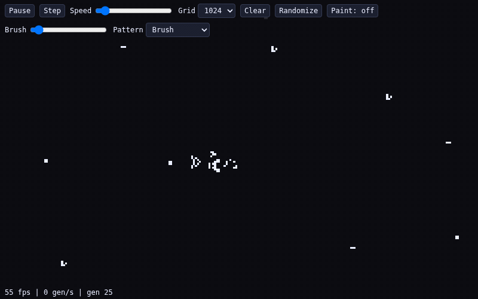
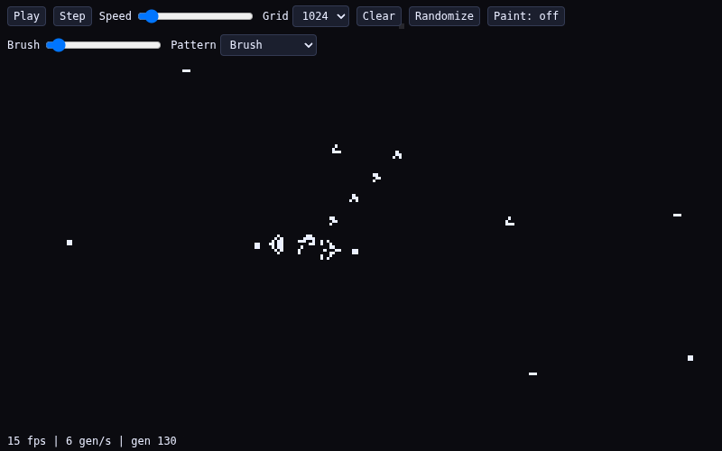

# Conway's Game of Life

Simulação do Jogo da Vida de Conway (B3/S23) no navegador, feita para rodar **milhões de células a ~60 fps**: HTML + JavaScript (ES modules) + WebGL2, com a simulação inteira executando em shader (ping-pong textures), sem dependências externas e sem desenhar célula por célula na CPU.





## Rodando localmente

Os ES modules exigem HTTP (não funciona abrindo o `index.html` via `file://`):

```bash
python3 -m http.server 8000
# abra http://localhost:8000/
```

Qualquer servidor estático serve (`npx serve`, `php -S`, etc.). Não há build, bundler ou dependência de runtime.

### Parâmetros de URL

| Parâmetro | Efeito |
|---|---|
| `?size=2048` | Tamanho do grid (potência de 2, limitado por `min(4096, MAX_TEXTURE_SIZE)`). Padrão: 1024. |
| `?sps=30` | Gerações por segundo iniciais (1–120 via slider; o parâmetro é o valor de carga). |
| `?seed=demo` | Estado inicial determinístico (PRNG mulberry32 com seed fixa). `?seed=<n>` usa o inteiro informado. Sem parâmetro: grid vazio. A seed também alimenta o hash de herança/mutação da simulação (mesmo mapeamento do fill: `demo` → constante fixa, ausente → 0, senão o inteiro) — loadings iguais evoluem bit-identicalmente. |
| `?mut=0.05` | Taxa de mutação por nascimento, em fração (0–1; clampado). Padrão: 0 (sem mutação, comportamento Stage 7 bit-exato). Cada nascimento sorteia via hash: com probabilidade `mut` flipa 1 dos 18 bits de regra e o recém-nascido ganha uma linhagem nova (id 1–63). Ver “Mutação e linhagens”. |
| `?freq=1` | Seleção dependente de frequência (Stage 10). Qualquer valor ≠ `0`/ausente liga; padrão desligado = Conway exato. Ver “Ecologia”. |
| `?energy=1` | Recurso de energia conservado (Stage 10). Liga a textura de eco + passe `eco.frag`. |
| `?niche=1` | Campo de nicho/terreno (Stage 10). Usa o mesmo par de texturas de eco. |
| `?age=1` | Ciclo de vida por idade (Stage 10): doador jovem não reproduz, morte natural crescente. |

## Controles

| Controle | Ação |
|---|---|
| **Play / Pause** | Liga/desliga o stepping automático do loop. |
| **Step** | Avança exatamente 1 geração (estando pausado). |
| **Speed** | Slider de gerações por segundo (1–120). Escalar puro — nenhuma alocação por frame. |
| **Grid** | Troca o tamanho do grid (1024/2048/4096). Realoca texturas/FBOs **uma única vez, fora do loop**, e reseta o estado. Opções acima de `min(4096, MAX_TEXTURE_SIZE)` ficam ocultas. |
| **Clear** | Zera o grid — um único upload `texSubImage2D` de um buffer zero pré-alocado. |
| **Randomize** | Preenche ~50% das células — preenche um buffer reutilizado e faz um único upload. |
| **Paint: on/off** | Alterna entre pintar e pan. Roda do mouse (zoom) funciona nos dois modos. |
| **Brush** | Tamanho do pincel (1–64 → raio). |
| **Pattern** | `Brush` pinta células; `Glider`/`Blinker`/`Gosper gun` dão o padrão inteiro no clique. Colocação é envolvida no toro (a borda direita continua na esquerda). |
| **Genome** | Preset do genoma pintado/stampado: `Conway B3/S23` (padrão) ou `HighLife B36/S23`. Células nascidas herdam o genoma de um vizinho vivo. |
| **Arrastar** | Pan (com pintura desligada) ou pintura contínua (com pintura ligada). |
| **Zoom** | Roda do mouse, centrado no cursor. |

## Validação (fidelidade da regra)

```bash
pnpm install   # só playwright-core, dev-dependency do harness
pnpm test
```

O harness (`tests/run.js`, Playwright + Chromium headless) roda **71 verificações** (os 49 testes originais, intocados, + 3 da Stage 6, + 4 da Stage 7, + 5 da Stage 8, + 4 da Stage 9, + 6 da Stage 10) e imprime PASS/FAIL por critério, com exit code ≠ 0 em falha. Ele valida:

- **Fidelidade bit-a-bit contra uma referência CPU da B3/S23**: blinker, block, glider (interior e **atravessando a costura do toro**), e Gosper gun por 60 gerações.
- **Golden do Gosper gun** (valores canônicos, não só CPU-vs-GPU): população **36/41/46** nas gerações 0/30/60 em grid 128², e os offsets exatos dos gliders emitidos (fixados no teste, derivados da referência CPU e conferidos contra as populações canônicas).
- Câmera: zoom mantém o ponto sob o cursor, pan com delta exato, resize preserva/redimensiona a vista.
- Interações: pintura em duas posições de câmera distintas, wrap nas costuras (borda e canto), patterns via DOM e via hooks, troca de grid 64→2048→4096 mantendo a regra.
- Uploads únicos de clear/randomize (contadores de `texSubImage2D`/`texImage2D`/`deleteTexture` no protótipo WebGL).
- **Higiene do loop**: 0 `readPixels` e 0 alocações de GL no loop de render; sem erros de página em toda a suíte.
- HUD (formato, cadência ~1 Hz) e determinismo do `?seed=`.
- **Byte layout (Stage 6):** células morta/viva com máscaras Conway gravadas, idade que sobe 1 por geração e satura em 127, morte zerando a idade e mantendo as máscaras (via `readRaw`).
- **Genoma por célula (Stage 7):** stamping com os presets Conway/HighLife afirmado via `readRaw`, nascimento herdando o genoma do vizinho escolhido pelo hash, n==8 indexando os bits do canal A, e grid misto Conway/HighLife bit-exato (uvec4) contra a referência CPU por 50 gerações — a prova de paridade do hash JS/GLSL (qualquer divergência diverge rápido).
- **Mutação e linhagens (Stage 8):** `mut=0`/ausente mantém o comportamento Stage 7 bit-exato e todos os ids de linhagem em 0; `mut=0.15` produz ids distintos em A bits2–7 com o grid GPU bit-exato (uvec4) contra a referência CPU com mutação por 50 gerações; cor: linhagem 0 mantém o branco-clássico e célula mutada bate (±8) com a referência HSL computada no teste para o id dela; HUD pausado conta as linhagens vivas (mundo Conway puro = 1, após mutações ≥ 2); e determinismo: duas loads com o mesmo `?seed=`+`?mut=` evoluem idênticas, com `?mut=` diferente divergem.
- **Explorador de novidade (Stage 9):** unitários dos filtros boring (morre/congelou/ruído) e da distância de novelty; determinismo byte-a-byte de `run.json`+`archive.json` entre duas execuções do explorador (mundos still-life em dirs temporários, o archive real nunca é tocado); smoke: still filtrado como frozen, entrada de galeria completa (`reproUrl` no formato certo, métricas numéricas, GIF presente quando ffmpeg existe / `gifSkip` explícito quando não).
- **Ecologia (Stage 10):** cada mecanismo (`?freq`, `?energy`, `?niche`, `?age`) bit-exato contra a referência CPU com eco (≥30–50 gerações); conservação: `sum(R+G)` da textura de eco constante a cada geração e igual a `ENERGY_E0 × população inicial`; nicho: campo atinge riqueza (`B ≥ 8`) e o bônus S234 diverge do baseline na geração esperada; combo com os quatro flags + `?mut=` bit-exato por 50 gerações (main + eco); e **sem texturas de eco quando `?energy`/`?niche` estão off** (`readEco` retorna `null`, contadores `textures=2`).

O `readPixels` acontece **exclusivamente fora do stepping automático**: no caminho de validação/teste e no tick de 1 Hz do HUD **somente com a simulação pausada** — nunca em handlers de input nem durante o stepping (comprovado pelo teste de higiene: 0 `readPixels` durante a medição com auto-stepping ligado).

## Resultados medidos

Ambiente: Chromium headless + **SwiftShader (rasterizador por software)** — ou seja, roda a CPU, não a GPU. Máquina de medição: Linux x86_64 (out/2026). Página isolada por medição, janela de 2 s. Números absolutos variam com a carga da máquina; o que importa são as **classes** (display independe do grid; sim cresce com O(size²)).

| Cenário | fps | Observação |
|---|---|---|
| Só display (sim pausada) @64² | ~60 | Display amostra a textura na tela. |
| Só display (sim pausada) @4096² | ~60 | **Igual à 64²** — o custo do display é O(pixels de tela), não O(grid). |
| Sim + display @64² (`sps=120`) | ~163 | 64² fragmentos de sim são triviais. |
| Sim + display @4096² (`sps=120`) | **~4.5–10.5** | 16.7M fragmentos × 9 `texelFetch` no rasterizador de **software**. |
| Sim + display @4096², Stage 7 (perfil da suíte) | **~5.5** | Regra por máscara + herança ativas: dentro da faixa da Stage 6 (4.5–10.5) — custo extra ≈ 0, os canais vêm dos mesmos 9 `texelFetch`. |
| Sim + display @4096², Stage 8 (`mut=0`, default) | **na mesma faixa** | `mut=0` mantém exatamente o caminho de código da Stage 7 (branch de mutação não entra; mesmo hash de herança por nascimento) — custo extra ≈ 0. Com `?mut>0` o custo é ~1 hash adicional por nascimento, o mesmo custo por nascimento já existente do herding. |
| Sim + display @4096², Stage 10 (default × cada flag × combo) | **na mesma faixa** | Todos os quatro mecanismos são **especializados em tempo de compilação** (`#define` injetado no load) — com flag off o bloco some do shader. Interpolação default×combo: 2,47 vs 2,49 gen/s; A/B contra o HEAD baseline: paridade. Ver “Ecologia”. |

Referência da Stage 5 (antes do byte layout, sob carga alta): display ~27 fps em 64² **e** 4096²; sim+display ~146–162 fps @64², ~4.5–6 fps @4096² — o decode por round-trip da Stage 6 é neutro dentro da variância de carga (o custo dominante continua sendo o rasterizador de software).

**Análise (evidência de profiling):** o shader de sim é O(size²) em fragmentos. Sob SwiftShader isso vira ~16.7M iterações de shader por geração na CPU — o gargalo é o rasterizador de software, não o código. Os testes de higiene e de classe (display @4096² na mesma classe que @64²) mostram que não há regressão arquitetural; em GPU real o fragmento shader de 16.7M texels é exatamente o tipo de carga paralela que placa gráfica resolve.

> **Sign-off do alvo de 60 fps (owner):** os números acima são de software GL (Chromium headless + SwiftShader). **Assinado e aceito pelo owner** — a meta de ~60 fps @4096² fica documentada como pendente de validação em hardware real; o shortfall (4.5–10 fps em software vs alvo) está aprovado como resultado do rasterizador de software, não como regressão arquitetural (evidência: display-only igual em 64² **e** 4096², sim+display 146–162 fps @64²). Números de GPU real, quando medidos, vão para a tabela acima *(issue #5 — critério de aceite fechado com sign-off)*.

## Encoding da regra e da malha

- **1 texel = 1 célula**; o estado vive em duas texturas RGBA8 em ping-pong (`textures[read]` → `textures[write]`), cada uma com seu FBO.
- **Byte layout por texel** (Stage 6): `R = (idade << 1) | viva` (idade = gerações consecutivas vivas, satura em 127); `G = máscara de nascimento` (bit n = nasce com n vizinhos; Conway B3 = `0b00001000`); `B = máscara de sobrevivência` (Conway S23 = `0b00001100`); `A = bit0 nasce com 8, bit1 sobrevive com 8, bits 2-7 id de linhagem` (0 no modo Conway).
- **Encoding normalizado:** RGBA8UI (renderização para texturas inteiras) não está disponível no stack de referência — sem `EXT_color_buffer_integer`, draws em FBOs inteiros produzem lixo (evidência na issue #6). Os bytes viajam como floats normalizados (v/255) e os shaders decodificam com `int(v * 255.0 + 0.5)` — **lossless para todos os 256 valores de byte** em highp, portável em qualquer WebGL2. Acima da linha de decode, o layout é byte a byte o especificado.
- **Linha de base:** índice `y * size + x`, com `y = 0` na **base** (`gl_FragCoord` é y-up; o upload via `texSubImage2D` usa a mesma convenção).
- **Regra por genoma (Stage 7) + mutação (Stage 8)** em `shaders/sim.frag.glsl`: célula morta indexa a **máscara de nascimento** `G[n]` (viva indexa a **máscara de sobrevivência** `B[n]`); `n == 8` indexa os bits do canal A (`A bit0` = nasce com 8, `A bit1` = sobrevive com 8). Ao nascer, a célula herda o genoma empacotado (**24 bits**: `G | B<<8 | A<<16`, linhagem incluída) do vizinho vivo escolhido por `hash(x, y, gen, seed) % livingCount` na ordem fixa de varredura (dy, dx ascendente); nascimentos sem vizinhos vivos (máscara B0) mantêm o próprio genoma do texel. Com todas as máscaras em Conway (o default), herdar = manter — os goldens continuam bit-exatos com o caminho novo ativo. Vizinhança por `texelFetch` + módulo `(q + size) % size` (toro).
- **Hash de herança (32-bit, idêntico em GLSL e JS)** — mesmo número de constantes, mesma ordem de operações:

  ```glsl
  // shaders/sim.frag.glsl — uint ops, wrap em 32 bits
  uint h = s;
  h ^= x * 374761393u;  h = (h ^ (h >> 13)) * 1274126177u;
  h ^= y * 2654435761u; h = (h ^ (h >> 16)) * 2246822519u;
  h ^= g * 3266489917u; h = (h ^ (h >> 15)) * 3266489917u;
  h ^= h >> 16;
  ```

  ```js
  // tests/run.js hashCell(x, y, g, s) — Math.imul = low 32 bits (igual ao uint do GLSL)
  let h = s >>> 0;
  h = (h ^ Math.imul(x >>> 0, 374761393)) >>> 0;
  h = Math.imul(h ^ (h >>> 13), 1274126177) >>> 0;
  h = (h ^ Math.imul(y >>> 0, 2654435761)) >>> 0;
  h = Math.imul(h ^ (h >>> 16), 2246822519) >>> 0;
  h = (h ^ Math.imul(g >>> 0, 3266489917)) >>> 0;
  h = Math.imul(h ^ (h >>> 15), 3266489917) >>> 0;
  h = (h ^ (h >>> 16)) >>> 0;
  ```

  `Math.imul` devolve os bits 0–31 do produto (idênticos ao multiply-wrap de `uint`); `>>> 0` normaliza para unsigned, e `>>>`/`^` sobre valores em [0, 2³²) equivalem aos shifts/XOR lógicos de `uint`. `seed` vem do parâmetro `?seed=` (mesmo mapeamento do fill determinístico: `demo` → constante fixa, ausente → 0, senão o inteiro); `gen` é a geração de partida do passo (`uGen`). O mesmo hash decide, no nascimento, o vizinho doador do genoma **e** (quando `?mut>0`) a rolagem de mutação e o id de linhagem novo — é por isso que loads iguais de `?seed=`+`?mut=` evoluem bit-identicalmente.
- Display pinta célula morta em `rgb(11,11,16)` e viva por **linhagem** (A bits2–7): id 0 mantém o clássico `rgb(235,240,255)`; ids 1–63 usam HSL com matiz de ângulo dourado (`fract(id × 0.6180339887) × 360°`, S=0.65, L=0.55), decodificado no próprio fragment shader (`hsl2rgb`, sem LUT).
- **Mutação e linhagens (Stage 8):** `?mut=` vira `mutBp` em pontos-base fixos (0–10000, clampado) — a comparação no shader é inteira (`h % 10000u < uMutBp`), sem floats cross-language. No nascimento, se a rolagem passa: `genome ^= 1u << ((h/10000u)%18u)` flipa 1 dos 18 bits de regra (domínio 0..17) e o recém-nascido recebe linhagem nova `1 + ((h>>9)%63)` em A bits2–7 (o XOR sempre muda o pack, então **todo evento de mutação recebe id novo**; sobreviventes e células stampadas **nunca** mudam de id). Mundo só com id 0 é bit-exato da Stage 7. O HUD, **só quando pausado**, mostra `| lineages: N` — contagem por um único `readPixels` full-grid + scan de 64 flags em JS, executada **exclusivamente no tick pausado de 1 Hz** (nunca durante o stepping automático e nunca dentro de handlers de input: a primeira sincronização de leitura depois de uma sessão de jogo drena a fila de software-GL acumulada — medido ~49 s em 4096² contra ~110 ms no estado estável — e bloquearia o dispatch de cliques; no tick, o valor aparece no máximo 1 s após pausar; o teste de higiene garante 0 `readPixels` com auto ligado).
- **Pintura/patterns/seed** entram por `texSubImage2D` direto na textura viva (até 4 splits quando o retângulo cruza a borda), escrevendo o byte layout com as máscaras do **genoma selecionado** (viva = `(1, G, B, 0)`, morta = `(0, G, B, 0)`; Conway = `(1,8,12,0)` / `(0,8,12,0)`). Sem alocação por evento (`patchBuf`/`packBuf`/`fullBuf` alocados uma vez).
- A próxima geração é **consumida do texel `read`** no passo seguinte — pinturas caem estritamente entre passos (single-threaded).
- Hooks de validação: `__life.read()` devolve canal 0 como 0/255 (contrato do harness); `__life.readRaw()` devolve os bytes brutos do layout — só fora do loop.

## Ecologia (Stage 10)

Quatro mecanismos anti-convergência, cada um ligável por flag de URL e **desligado por padrão** (mundo default = Conway bit-exato, goldens intactos). Cada flag é parseada uma vez no load; qualquer valor exceto `0`/ausente liga.

| Flag | Mecanismo | Constantes |
|---|---|---|
| `?freq=1` | **Seleção por frequência:** sobrevivente com ≥ `FREQ_PENALTY_T` vizinhos vivos “parecidos” (distância `popcount18(self ^ vizinho) ≤ FREQ_SIM_DIST` sobre os 18 bits de genoma) morre — dinâmica RPS com a mutação da Stage 8. | `FREQ_SIM_DIST = 4`, `FREQ_PENALTY_T = 4` |
| `?energy=1` | **Energia conservada:** energia vive no par de texturas de eco (canal R = energia da célula, G = pool do local). Morte funde R→G no pool (nada é criado); nascimento exige `pool ≥ ENERGY_B_MIN` (senão o nascimento é veto e a célula mantém o genoma original) e o filho recebe metade do pool (R←`g>>1`). Invariante por texel: `R + G` só se desloca entre célula e pool ⇒ **soma global constante = `ENERGY_E0 × população inicial`** (assertado a cada geração no teste). | `ENERGY_E0 = 8`, `ENERGY_B_MIN = 8` |
| `?niche=1` | **Campo de nicho (terreno):** canal B do eco, monotônico — **morte** escreve `+1` no local (satura em 255, sem escrita em nascimento; ver nota abaixo), sobrevivente com ≥ 1 vizinho vivo sobre terreno rico (`B ≥ NICH_T`) ganha sobrevivência com n==4 (bônus `S23 → S234`). | `NICH_T = 8` |
| `?age=1` | **Idade no ciclo de vida:** doador com idade `< AGE_Y_MIN` veta o nascimento; sobrevivente com idade `≥ AGE_DEATH_START` morre com chance `min(10000, (idade−AGE_DEATH_START+1)·AGE_DEATH_STEP_BP)` em pontos-base via o hash da célula. | `AGE_Y_MIN = 4`, `AGE_DEATH_START = 32`, `AGE_DEATH_STEP_BP = 800` |

Todas as constantes são **espelhadas três vezes** e devem ser alteradas juntas: `const` no `shaders/sim.frag.glsl`, `ENERGY_E0`/objeto em `main.js`, objeto `ECO` em `tests/run.js` (a referência CPU é a autoridade dos testes).

**Nota de projeto sobre o nicho (revisado com evidência):** a semântica original do plano (+1 morte / −1 nascimento) era estruturalmente inerte — mortes/nascimentos em um local alternam estritamente, logo `B ∈ {0,1}` para sempre, `NICH_T = 8` era inalcançável e o bônus S234 nunca disparava (célula viva sempre fica em `B = 0`). A semântica implementada é **cicatriz de morte monotônica** (+1 por morte, sem escrita em nascimento): com `seed=7` a sopa atinge `maxB = 16` na geração 50, com células em bônus desde a geração 30, divergindo do baseline na geração 25 (sonda CPU + teste). Registrado na issue #10.

**Decisão de armazenamento (evidência na issue #10):** MRT RGBA8UI está quebrado no stack de referência (attachment 1 → `GL_INVALID_OPERATION 1286`, fica zerado; mistura RGBA8+RGBA16F também falha). Fallback escolhido: **segundo par ping-pong RGBA8** (`ecoTextures`) + passe `shaders/eco.frag.glsl` que difere `main-read` vs `main-write` para achar nascimentos/mortes (sem duplicar a regra), desenhado **apenas** quando `?energy=1 || ?niche=1`. Inicialização do eco vem da CPU (`fillEcoBuf` a partir dos bits vivos — nunca `readPixels`). `?freq`/`?age` são puramente do shader de sim (sem texturas extras).

**Especialização em tempo de compilação:** branches uniforme *dentro* do loop de vizinhança custavam ~40% do fps @4096² mesmo nunca executados (medido no SwiftShader). O load injeta `#define FREQ/ENERGY/NICHE/AGE` (0/1) após a diretiva `#version` e todo o bloco stage-10 fica sob `#if` — flag off ⇒ código pré-processado embora ⇒ o shader default compila o mesmo caminho da Stage 8. Interpolação default×combo @4096²: 2,47 vs 2,49 gen/s (paridade); A/B contra o HEAD baseline: paridade.

## Explorador de novidade (Stage 9)

`tools/explore.js` (Node + playwright-core, self-contained — servidor/launch copiados do padrão do harness, `tests/run.js` intocado) roda uma matriz de mundos headless e guarda só o que é interessante:

```
node tools/explore.js --size 64 --gens 120 --worlds 8 --seed-base 1 --mut 0.05
```

Flags: `--size`, `--gens`, `--worlds` (K seeds a partir de `--seed-base`), `--mut`, `--genome conway|highlife`, `--tau` (limiar de novelty, padrão 0.35), `--archive` (padrão `tools/gallery/archive.json`), `--out` (padrão `tools/gallery/`), `--pattern soup|still`, `--no-gif`, `--force-keep` (debug/teste: mantém até os chatos). Cada mundo é aberto em `?size=&seed=&mut=` com auto desligado e avançado em lotes via `__life.step(k)` — nenhum readback dentro do rAF (caminho de validação; a higiene do loop continua verde).

**Métricas** (vetor fixo em [0,1], ordem fixa no archive): `activityMean`/`activityStd` (série da fração viva por snapshot), `spatialEntropy` (Shannon do histograma de vizinhos vivos, normalizada por log2 9), `compressibility` (razão zlib do bit-pack vivo; ≈1 = ruído), `movingComponents` (componentes 8-conectados cujo centroide move >1 célula entre snapshots, /16), `persistence` (pop final / pop máx), `lineageDiversity` (ids distintos / 64, stage 8), `stability` (fração de células inalteradas entre os dois últimos snapshots).

**Filtros boring** (limiares fixos no topo do arquivo, documentados): morre = pop final 0; congela = `stability ≥ 0.9999` (still life); ruído = `activityMean > 0.35` **e** `compressibility > 0.55` **e** `stability < 0.3`. Osciladores não são boring. **Novelty**: distância euclidiana no vetor normalizado; mantém se `min distância ao arquivo ≥ τ` (τ via `--tau`). O archive é **gitignorado** (local; curadoria versionada fica para decisão futura).

**Saída**: `run.json` (métricas de todos os mundos — determinístico, sem timestamps) + `archive.json` atualizado; por mundo mantido, `tools/gallery/<id>/` com `metrics.json` (params + `reproUrl` = `index.html?size=&seed=&mut=` + métricas) e `anim.gif` curto (~20 frames stepped via `readScreen` 256² → pipe `rawvideo` → ffmpeg `palettegen/paletteuse`; sem ffmpeg no PATH, `gifSkip: "ffmpeg not found"` — nunca falha). Mesma config ⇒ mesmas métricas byte-a-byte (mesmo stack gráfico) — afirmado por teste no `pnpm test`.

**Throughput medido** (SwiftShader, mesma máquina das medições acima): ~46 mundos/min a 64² com 60 gerações e GIF ligado — 100 mundos ≈ 2,2 min. `--no-gif` e grids menores aumentam bastante; a matriz real é uma questão de paciência, não de infra.

## Como foi desenvolvido

Este repositório é também um experimento de **orquestração por agente** — o desenvolvimento foi conduzido com o opencode e duas comandos customizadas, com a issue do GitHub como única fonte da verdade de cada etapa:

- **`AGENTS.md`** define apenas as regras inegociáveis do projeto (stack fixa, simulação só na GPU, zero alocação no loop, fidelidade validada, etc.).
- **Agente `gt`** (em `~/.config/opencode/agents/gt.md`): um agente **só de planejamento e fechamento** — ele só lê o código, explora o repo e escreve planos e issues; **nunca edita arquivos**. Ele tem permissão para `gh issue *` (abrir/comentar/fechar issues), leitura e execução de testes, mas nada de escrita em código.
- **`/gt <repo> <prompt>`** — kickoff: cria uma issue por etapa a partir do prompt, em ordem, com label `stage` e `Blocked by #anterior`, **sem** o label `planned` (a estrutura vem do kickoff; o plano vem depois).
- **`/gt plan <N>`** (alias `/gt plan stage <N>`) e **`/gt plan all`** — o **único** comando que planeja: anexa o plano completo com títulos fixos (Goal, Scope, abordagem, passos, Tests com o comando exato de teste, critérios `- [ ]`, riscos) como comentário e adiciona `planned`. Com `all`, planeja de uma vez todas as stage issues abertas ainda não planejadas; com `--dry-run`, mostra o esboço na conversa sem gravar nada.
- **`/gt next`** — se a etapa atual está `planned`: confere os critérios de aceite; se todos marcados **e os testes passarem**, **fecha** a issue. Se algo falta, lista o que falta e para. Se a próxima etapa não foi planejada, apenas indica `/gt plan <N>` (não planeja).
- **Modo Build** — implementa o plano na issue, marca os critérios conforme são atendidos, e commita apenas via **`/cp gt`** (que anexa `(#N)` da issue da etapa na mensagem do commit convencional e avisa se ainda há critérios desmarcados).
- **`/gt skip`** — pula a etapa atual (comenta, label `skipped`, fecha como *not planned*) e indica o `/gt plan <N>` da próxima.
- **Auxiliares** — `/gt status` (painel das etapas com % de critérios), `/gt verify <N>` (roda os testes sem fechar), `/gt replan <N>` (remove `planned` e re-plana), `/gt retro <N>` (retrospective na issue), `/gt log` (changelog das fechadas).

Fluxo completo por etapa:

```
/gt <repo> <prompt>          cria as issues (estrutura das etapas)
        ↓
/gt plan <N>  →  modo Build (implementa, testa, marca critérios, /cp gt)
        ↑___________________________↓
        /gt next (confere e fecha N)  →  /gt plan <N+1>  →  repete
```

Labels: `stage` (toda issue de etapa), `planned` (planejada/em implementação), `skipped` (pulada). Nenhuma etapa avança enquanto a anterior estiver aberta, exceto com `/gt skip`.

> **Para quem quiser usar esse workflow:** vou criar um **repositório/documentação dedicado** (comandos `/gt` e `/cp`, agente `gt`, `AGENTS.md` de exemplo e o passo a passo completo), para que qualquer pessoa possa usufruir do método em qualquer projeto. Fique de olho neste repositório — o link deve aparecer aqui quando ficar pronto.

### Issues por etapa

| Etapa | Issue | Status |
|---|---|---|
| 1 — Scaffold e contexto WebGL2 | #1 | fechada |
| 2 — Núcleo de simulação GPU (B3/S23, ping-pong) | #2 | fechada |
| 3 — Renderização e câmera (pan/zoom) | #3 | fechada |
| 4 — Interação, patterns e controles | #4 | fechada |
| 5 — Validação e performance em escala | #5 | fechada |
| 6 — Formato RGBA8UI + modo Conway equivalente | #6 | fechada |
| 7 — Genoma por célula + herança determinística | #7 | fechada |
| 8 — Mutação + linhagens + cor | #8 | fechada |
| 9 — Explorador de novidade (novelty search) | #9 | fechada |
| 10 — Ecologia — seleção, energia, nicho, idade | #10 | esta |
| 11 — Experimentos de regras pouco exploradas | #11 | aberta |

## Regras do projeto

Veja [AGENTS.md](./AGENTS.md) — stack fixa (HTML + JS + WebGL2, sem framework/bundler), simulação sempre na GPU, zero alocações no loop de render, fidelidade à regra B3/S23 validada com glider, blinker e Gosper glider gun, e performance primeiro.

## Estrutura

```
index.html        página + toolbar + HUD (sem framework)
main.js           app WebGL2: context, sim pass, eco pass, display pass, uploads, controles
shaders/          sim.vert / sim.frag (genoma + mutação/linhagem + ecologia via #if) / eco.frag (pool+campo) / display.frag
tools/explore.js  explorador de novidade headless (stage 9)
tools/gallery/    saída do explorador (gitignorado: run.json, archive.json, achados)
tests/run.js      harness headless (pnpm test)
assets/           screenshot + gif usados neste README
```
